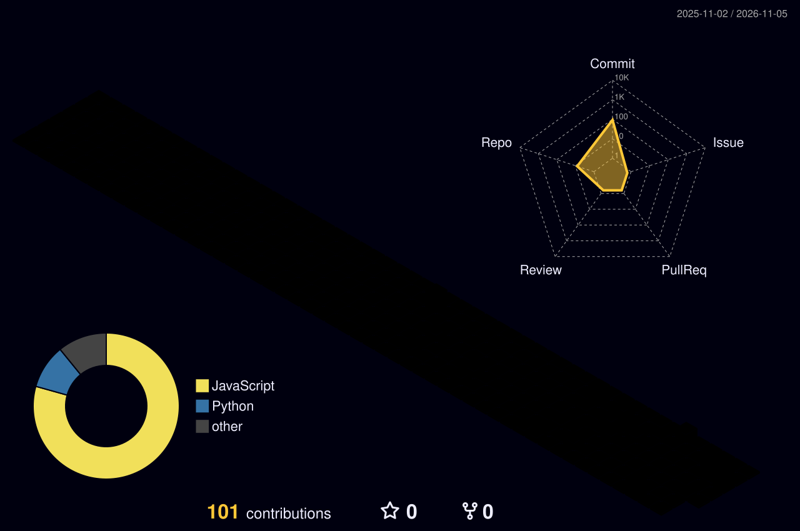

 

---

## About

I am a Python developer focused on building practical, data-driven applications. My current work centres on **AI-powered e-commerce systems**: recommendation engines, forecasting, and intelligent customer support. I enjoy turning ideas into clean, working software and I am continuously improving my skills in machine learning and backend development.

**Currently:** Building Ecommerce-AI  |  **Learning:** Machine Learning, FastAPI, Three.js  |  **Open to:** Collaboration and internships

---

## 3D Contribution Graph

  

---

## Technical Skills

| Category | Technologies |
|:--|:--|
| **Languages** |     |
| **AI / Data** |    |
| **Tools** |    |

> Sirf wohi skills rakhein jo aap waqai istemal karte hain.

---

## Featured Project

### [Ecommerce-AI](https://github.com/Aliraza8284/Ecommerce-ai)
An intelligent e-commerce platform that combines machine learning with real-time analytics.

- Personalized product recommendations
- Sales forecasting and price optimization
- AI customer support chatbot
- Sentiment analysis and live analytics dashboard

`Python` `Machine Learning` `Analytics`

---

## GitHub Statistics

---

  

